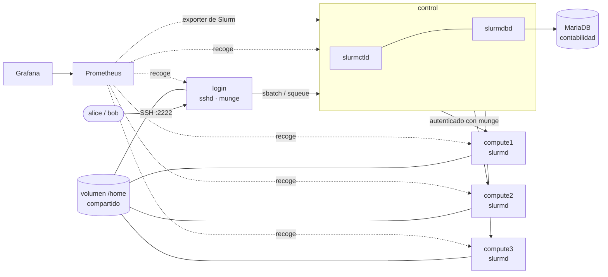
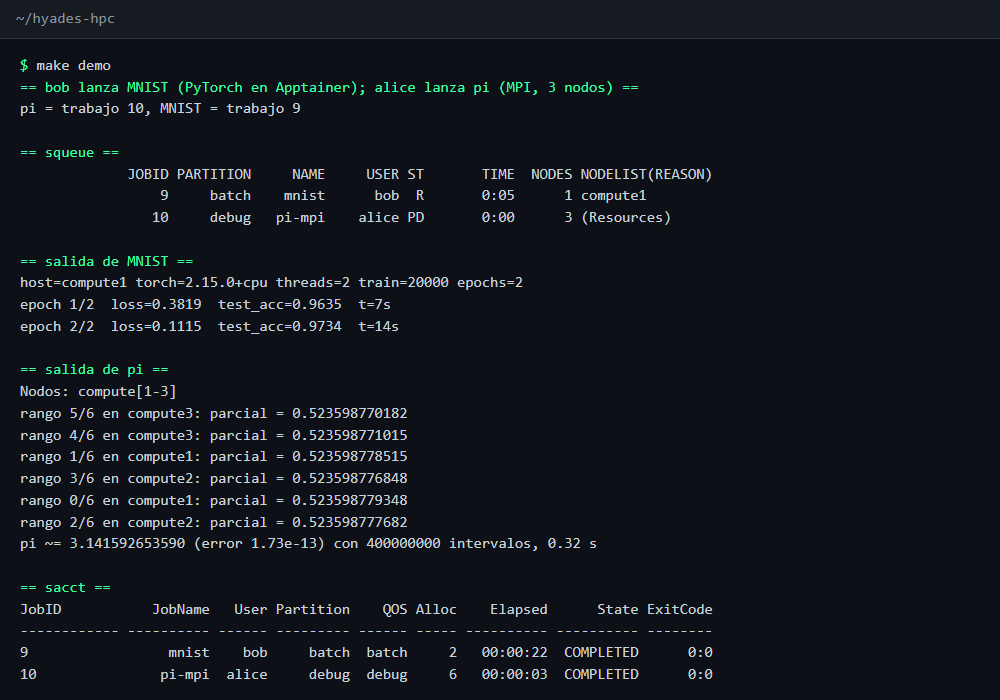
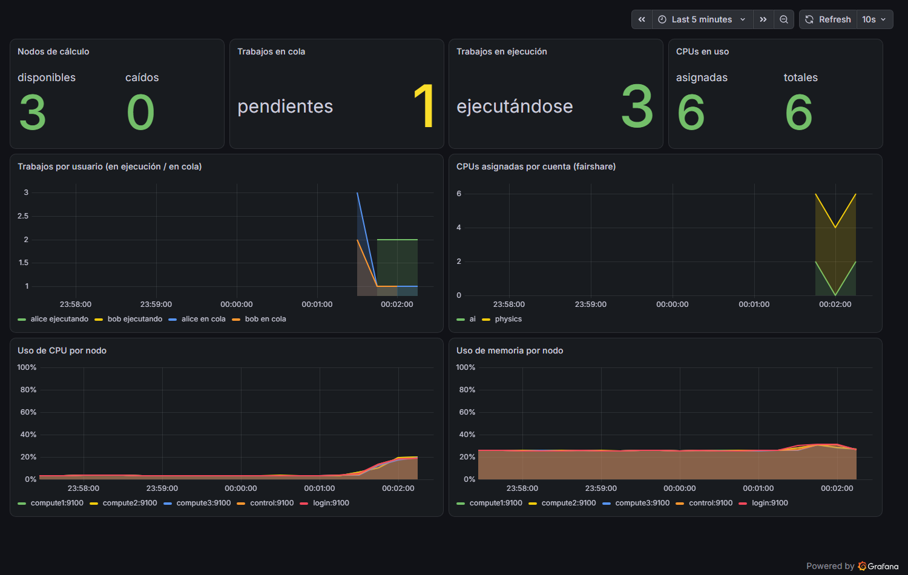

# Hyades — un clúster HPC en miniatura con Docker Compose

Español · [English](README.md)

> **Esto es un laboratorio y un proyecto de portfolio, no un supercomputador.** Todo corre en contenedores
> de una sola máquina y comparte su CPU, su memoria y su kernel. Hyades reproduce la *arquitectura* de un
> centro HPC (como el FinisTerrae del CESGA) para poder montarla, romperla y entenderla en un portátil.
> No sirve para cargas de trabajo reales.

El nombre viene del cúmulo estelar de las Híades: cada nodo es una estrella del cúmulo.



## Qué incluye

| Pieza | Función |
|---|---|
| `control` | `slurmctld` (planificador) y `slurmdbd` (contabilidad), ambos como usuario `slurm` sin privilegios |
| `mariadb` | base de datos de contabilidad (`sacct`, fairshare) |
| `compute1-3` | `slurmd`, Apptainer, OpenMPI |
| `login` | punto de entrada SSH para los usuarios (solo claves, sin contraseñas) |
| munge | autenticación por clave compartida entre todos los nodos |
| `/home` | un volumen compartido por todos los nodos |
| Prometheus + exporters | `node_exporter` en cada nodo y un exporter de Slurm en `control` |
| Grafana | panel ya configurado: nodos, cola, trabajos en ejecución, CPU y memoria |

Imagen base de todo: **Rocky Linux 9** (la habitual en los centros HPC). Las imágenes y binarios de
terceros están fijados por digest, o por versión y checksum.

## Cómo arrancarlo

Requisitos: Docker con Compose v2, `make` y unos 6 GB de RAM libres.

```sh
make up        # construye y arranca el clúster; la primera vez construye la imagen de IA (~4 min)
make demo      # lanza los trabajos de ejemplo y muestra la cola y la contabilidad (~40 s)
make ssh       # terminal en el nodo de acceso como alice (U=bob para bob)
make grafana-password   # contraseña de admin de Grafana (usuario: admin)
make down      # parar (conserva los datos)    make clean   # borrar todo, incluidos los secretos
```

* SSH: `make ssh`, o `ssh -p 2222 -i <clave> alice@localhost`. Las claves privadas de los usuarios están en
  el volumen `secrets` (`/secrets/users/<nombre>/id_ed25519`).
* Grafana: <http://localhost:3000> (el panel se ve sin iniciar sesión; administrar exige la contraseña).
  Prometheus: <http://localhost:9090>. Los dos escuchan solo en `127.0.0.1`.
* **No hay contraseñas ni claves en el repositorio.** La clave de munge, la contraseña de la base de datos,
  las claves SSH y la contraseña de Grafana se generan en el primer arranque y se guardan en el volumen
  Docker `secrets`.

### Trabajos de ejemplo

* `jobs/pi/pi_mpi.sbatch` — calcula π con MPI: 6 rangos repartidos en los 3 nodos.
* `jobs/ai/mnist.sbatch` — entrena una CNN pequeña con MNIST usando **PyTorch en CPU**, lanzada con
  `sbatch` **dentro de un contenedor Apptainer** (`jobs/ai/mnist.def`, también sobre Rocky 9; el conjunto
  de datos va dentro de la imagen, así que los nodos no necesitan Internet). Usa 20 000 imágenes y 2 épocas
  (~97 % de acierto en test) para que `make demo` sea corto.



### Monitorización



## Usuarios, particiones y QoS

* Dos usuarios sin privilegios: `alice` (cuenta `physics`, fairshare 60) y `bob` (cuenta `ai`, fairshare 40).
* Particiones: `debug` (10 min como máximo, QoS `debug`, prioridad 100, 2 trabajos por usuario) y `batch`
  (por defecto, 1 día, QoS `batch`, prioridad 10, **máximo 4 CPUs por usuario**).
* La prioridad es multifactor: fairshare + QoS + antigüedad. El uso se guarda en `slurmdbd` y se lee con
  `sacct`.

### Caso práctico: «¿por qué mi trabajo está pendiente?» (`QOSMaxCpuPerUserLimit`)

Al montar el ejemplo de MPI, el trabajo de `alice` se quedó en la cola con el clúster libre:

```
$ squeue
 JOBID PARTITION   NAME  USER ST TIME NODES NODELIST(REASON)
     1     debug pi-mpi alice PD 0:00     3 (QOSMaxCpuPerUserLimit)
```

Diagnóstico, como administrador:

```sh
scontrol show job 1 | grep -E 'QOS|Partition|NumCPUs'     # QOS=batch, 6 CPUs pedidas
sacctmgr show qos format=name,priority,maxtrespu,maxjobspu,maxwall
sacctmgr show assoc where user=alice format=user,account,defaultqos,qos
```

El trabajo pedía 6 CPUs, pero la QoS con la que corría (`batch`, la QoS *por defecto* de alice) limita a
4 CPUs por usuario. La QoS de la partición (`debug`) no se aplicó porque **la QoS del trabajo manda sobre la
de la partición**. Hay dos arreglos correctos, según lo que se quiera:

1. Pedir la QoS adecuada: `#SBATCH --qos=debug` (lo que hace el ejemplo).
2. Cambiar la política, si el límite está mal: `sacctmgr modify qos batch set MaxTRESPerUser=cpu=6`.

La lección: los límites viven en la *base de datos de contabilidad* (asociaciones y QoS), no solo en
`slurm.conf`, y `AccountingStorageEnforce=associations,limits,qos` es lo que hace que se apliquen.

## Qué aprende un administrador con cada pieza

| Pieza | Qué se practica |
|---|---|
| munge | secretos compartidos, coherencia de reloj y UIDs; por qué `slurmctld` y `slurmd` no hablan sin él |
| `slurmctld` / `slurm.conf` | definición de nodos y particiones, planificador, pesos de prioridad |
| `slurmdbd` + MariaDB | contabilidad, asociaciones, QoS, fairshare; `sacctmgr` y `sacct` |
| `slurmd` y cgroups | por qué los demonios necesitan cgroups y qué cambia sin systemd |
| nodo de acceso | separar a los usuarios del plano de control; SSH solo con clave; sin root |
| `/home` compartido | por qué todos los nodos deben ver los mismos ficheros y UIDs |
| Apptainer | ejecutar contenedores como usuario normal (sin demonio Docker en HPC) |
| OpenMPI | un trabajo en varios nodos; cómo se reparten los rangos con `--nodes` y `--ntasks-per-node` |
| Prometheus + Grafana | objetivos, exporters, qué poner en un panel de operaciones |

## Notas de seguridad

* Nada corre como root salvo lo imprescindible: `sshd` (login), `slurmd` (lanza los trabajos como cada
  usuario) y el `init` de un solo uso que genera los secretos. `slurmctld`, `slurmdbd`, `munged` y los
  exporters corren con usuarios sin privilegios. La imagen de Apptainer se construye una vez como root (tarea
  de administración); los trabajos corren sin privilegios.
* Los usuarios entran con clave SSH; el acceso de root y las contraseñas están desactivados.
* Prometheus y Grafana solo escuchan en `127.0.0.1` y no hay TLS (ver limitaciones).

## Limitaciones

* **Slurm 22.05** viene de EPEL 9 y está **fuera del soporte del proyecto** (sin parches de seguridad).
  Vale para aprender; no expongas este clúster a una red.
* **OpenHPC** sería una mejora natural (Slurm actual, pilas MPI, `lmod`), pero se instala en `/opt/ohpc`
  con otras rutas y obligaría a rehacer la imagen base. Queda como trabajo futuro.
* **`/home` es un volumen Docker, no NFS.** Un servidor NFS en un contenedor necesita privilegios y módulos
  del kernel que Docker gestiona mal. El volumen da el mismo comportamiento (un único espacio visto por
  todos los nodos), pero sin las lecciones de bloqueos, caché ni `root_squash` de NFS.
* **Los nodos de cálculo son `privileged`**, porque Apptainer necesita user namespaces y `slurmd` necesita
  escribir cgroups, y el perfil por defecto de Docker bloquea ambas cosas. Los nodos de control y de acceso
  no son privilegiados. Un clúster real no haría esto.
* **`node_exporter` mide el host.** Los contenedores comparten el kernel, así que la CPU y la memoria salen
  casi iguales en todos los nodos. Lo que sí cambia entre nodos son las cifras de Slurm (nodos, cola, CPUs
  asignadas).
* Los nodos declaran 2 CPUs cada uno, pero comparten los núcleos reales del host: los tiempos no son
  significativos. Slurm no *fuerza* límites de CPU ni de memoria (`ConstrainCores=no`,
  `ConstrainRAMSpace=no`).
* Un solo controlador, sin alta disponibilidad, sin expulsión de trabajos, sin GPUs, sin InfiniBand.
* Grafana permite lectura anónima y nada usa TLS: bien en `127.0.0.1`, mal en cualquier otro sitio.
* El trabajo de MNIST es deliberadamente diminuto (20 000 imágenes, 2 épocas).

## Estructura

```
Dockerfile  docker-compose.yml  Makefile
config/     slurm.conf, cgroup.conf, plantilla de slurmdbd, sshd, prometheus, grafana (provisionado)
jobs/       pi/ (MPI)   ai/ (PyTorch + Apptainer)
scripts/    entrypoint, init (secretos), accounting (QoS, cuentas), demo, prueba de humo de CI
```

## CI

GitHub Actions levanta el clúster y ejecuta el ejemplo de MPI como `alice`, comprobando que π es correcto,
que han corrido seis rangos y que `sacct` dice `COMPLETED`. Las acciones están fijadas por SHA de commit y el
workflow tiene permisos de solo lectura.

## Licencia

[AGPL-3.0-only](LICENSE).
