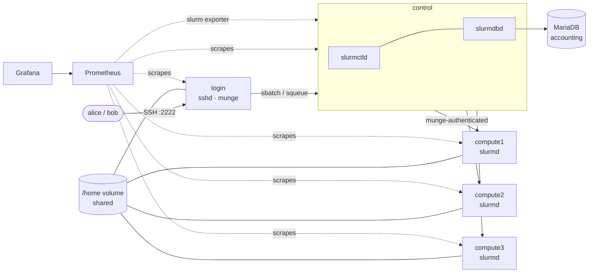
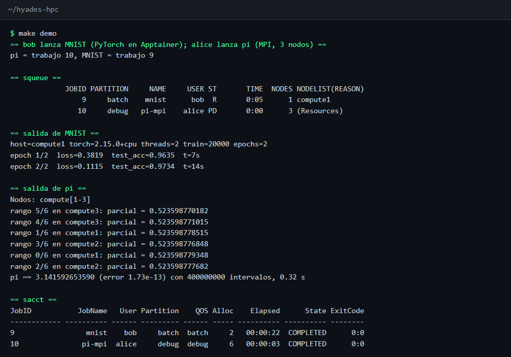
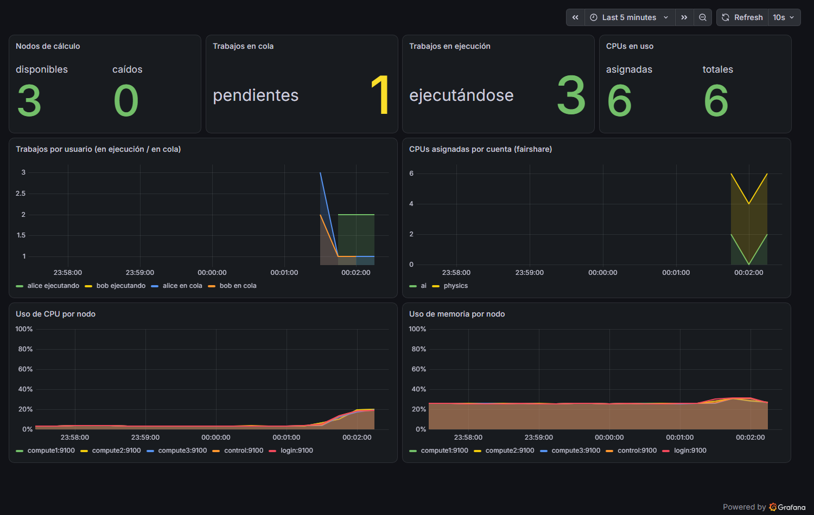

# Hyades — a miniature HPC cluster in Docker Compose

[Español](README.es.md) · English

**Live demo:** <https://hyades.fizsar.com>

> **This is a lab and a portfolio project, not a supercomputer.** Everything runs
> as containers on one machine and shares its CPU, memory and kernel. Hyades
> reproduces the *architecture* of an HPC centre (such as CESGA's FinisTerrae) so
> that its pieces can be built, broken and understood on a laptop. It is not
> meant for real workloads.

The name comes from the Hyades star cluster: every node is a star of the cluster.



## What is in it

| Piece | Role |
|---|---|
| `control` | `slurmctld` (scheduler) and `slurmdbd` (accounting), both as the unprivileged `slurm` user |
| `mariadb` | accounting database (`sacct`, fairshare) |
| `compute1-3` | `slurmd`, Apptainer, OpenMPI |
| `login` | SSH entry point for users (keys only, no passwords) |
| munge | shared-key authentication between all nodes |
| `/home` | one volume shared by all nodes |
| Prometheus + exporters | `node_exporter` on every node, a Slurm exporter on `control` |
| Grafana | provisioned dashboard: nodes, queue, running jobs, CPU and memory |

Base image for everything: **Rocky Linux 9** (the usual choice in HPC centres).
Third-party images and binaries are pinned by digest or version + checksum.

## Quick start

Requirements: Docker with Compose v2, `make`, about 6 GB of free RAM.

```sh
make up        # builds and starts the cluster; builds the AI image the first time (~4 min)
make demo      # runs the example jobs and shows the queue and accounting (~40 s)
make ssh       # shell on the login node as alice (U=bob for bob)
make grafana-password   # admin password for Grafana (user: admin)
make down      # stop (keeps data)    make clean   # remove everything, including secrets
```

* SSH: `make ssh`, or `ssh -p 2222 -i <key> alice@localhost`. The users' private keys live in the
  `secrets` volume (`/secrets/users/<name>/id_ed25519`).
* Grafana: <http://localhost:3000> (the dashboard is readable without logging in; administering needs the
  password). Prometheus: <http://localhost:9090>. Both listen on `127.0.0.1` only.
* **No passwords or keys are in the repository.** The munge key, the database password, the SSH keys and
  the Grafana password are generated on the first start and stored in the `secrets` Docker volume.

### Example jobs

* `jobs/pi/pi_mpi.sbatch` — computes π with MPI: 6 ranks spread over the 3 nodes.
* `jobs/ai/mnist.sbatch` — trains a small CNN on MNIST with **PyTorch on CPU**, run with `sbatch`
  **inside an Apptainer container** (`jobs/ai/mnist.def`, also on Rocky 9; the dataset is baked into the
  image, so the nodes do not need Internet). It uses 20 000 images and 2 epochs (~97 % test accuracy)
  so that `make demo` stays short.



### Monitoring



## Users, partitions and QoS

* Two unprivileged users, `alice` (account `physics`, fairshare 60) and `bob` (account `ai`, fairshare 40).
* Partitions: `debug` (10 min max, QoS `debug`, priority 100, 2 jobs per user) and `batch` (default, 1 day,
  QoS `batch`, priority 10, **at most 4 CPUs per user**).
* Priority is multifactor: fairshare + QoS + age. Usage is recorded in `slurmdbd` and read with `sacct`.

### Case study: "why is my job pending?" (`QOSMaxCpuPerUserLimit`)

While building the MPI example, `alice`'s job sat in the queue with the cluster idle:

```
$ squeue
 JOBID PARTITION   NAME  USER ST TIME NODES NODELIST(REASON)
     1     debug pi-mpi alice PD 0:00     3 (QOSMaxCpuPerUserLimit)
```

Diagnosis, as an administrator:

```sh
scontrol show job 1 | grep -E 'QOS|Partition|NumCPUs'     # QOS=batch, 6 CPUs requested
sacctmgr show qos format=name,priority,maxtrespu,maxjobspu,maxwall
sacctmgr show assoc where user=alice format=user,account,defaultqos,qos
```

The job asked for 6 CPUs, but the QoS it was running under (`batch`, alice's *default* QoS) caps a user at
4 CPUs. The partition's QoS (`debug`) did not apply because the **job's QoS wins over the partition's**.
Two correct fixes, depending on intent:

1. Ask for the right QoS: `#SBATCH --qos=debug` (what the example does).
2. Change the policy, if the limit is wrong: `sacctmgr modify qos batch set MaxTRESPerUser=cpu=6`.

The lesson: limits live in the *accounting database* (associations and QoS), not only in `slurm.conf`, and
`AccountingStorageEnforce=associations,limits,qos` is what makes them bite.

## What an administrator learns from each piece

| Piece | You practise |
|---|---|
| munge | shared secrets, clock and UID consistency; why `slurmctld` and `slurmd` refuse to talk without it |
| `slurmctld` / `slurm.conf` | node and partition definitions, scheduler, priority weights |
| `slurmdbd` + MariaDB | accounting, associations, QoS, fairshare; `sacctmgr` and `sacct` |
| `slurmd` and cgroups | why daemons need cgroup access, and what changes without systemd |
| login node | separating users from the control plane; key-only SSH; no root login |
| shared `/home` | why every node must see the same files and UIDs |
| Apptainer | running containers as a normal user (no Docker daemon on HPC) |
| OpenMPI | one job across nodes; how ranks map to `--nodes` and `--ntasks-per-node` |
| Prometheus + Grafana | scrape targets, exporters, what to put on an operations dashboard |

## Security notes

* Nothing runs as root except what has to: `sshd` (login), `slurmd` (it starts jobs as each user) and
  the one-shot `init` that generates secrets. `slurmctld`, `slurmdbd`, `munged` and the exporters run as
  unprivileged users. The Apptainer image is built as root once (an admin task); jobs run unprivileged.
* Users authenticate by SSH key; root login and passwords are disabled.
* Prometheus and Grafana only listen on `127.0.0.1`, and there is no TLS (see limitations).

## Limitations

* **Slurm 22.05** comes from EPEL 9 and is **out of upstream support** (no security fixes). It is enough
  to learn on; do not expose this cluster to a network.
* **OpenHPC** is a natural improvement (current Slurm, MPI stacks, `lmod`), but it installs under
  `/opt/ohpc` with different paths and would mean reworking the base image. Left as future work.
* **`/home` is a Docker volume, not NFS.** An NFS server in a container needs privileges and kernel
  modules that Docker handles badly. A volume gives the same behaviour (one namespace seen by all nodes)
  with none of NFS's locking, caching or `root_squash` lessons.
* **The compute nodes run `privileged`** because Apptainer needs user namespaces and `slurmd` needs to
  write cgroups, and Docker's default profile blocks both. The control and login nodes are not privileged.
  A real cluster would not do this.
* **`node_exporter` measures the host.** Containers share the host kernel, so CPU and memory look almost
  identical on every node. The Slurm numbers (nodes, queue, CPUs allocated) are the ones that differ.
* The nodes declare 2 CPUs each, but they share the host's real cores: timings are not meaningful.
  Slurm does not *enforce* CPU or memory limits (`ConstrainCores=no`, `ConstrainRAMSpace=no`).
* One controller, no HA, no backup controller, no job preemption, no GPUs, no InfiniBand.
* Grafana allows anonymous read-only access and nothing uses TLS: fine on `127.0.0.1`, not elsewhere.
* The MNIST job is deliberately tiny (20 000 images, 2 epochs).

## Layout

```
Dockerfile  docker-compose.yml  Makefile
config/     slurm.conf, cgroup.conf, slurmdbd template, sshd, prometheus, grafana (provisioned)
jobs/       pi/ (MPI)   ai/ (PyTorch + Apptainer)
scripts/    entrypoint, init (secrets), accounting (QoS, accounts), demo, CI smoke test
```

## CI

GitHub Actions starts the cluster and runs the MPI example as `alice`, checking that π is right, that six
ranks ran and that `sacct` reports `COMPLETED`. Actions are pinned by commit SHA and the workflow has
read-only permissions.

## License

[AGPL-3.0-only](LICENSE).
